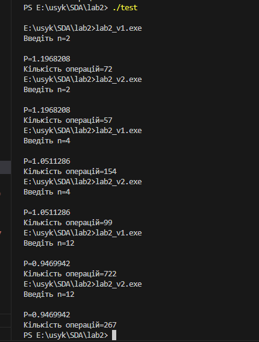
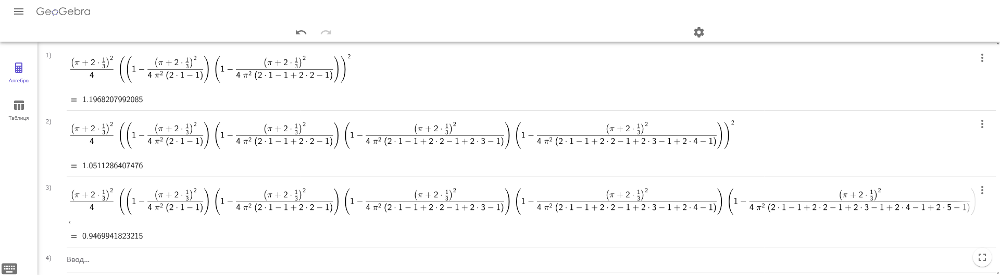
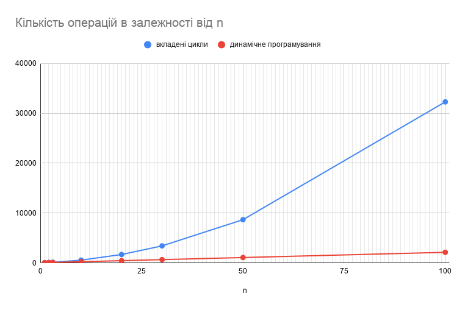
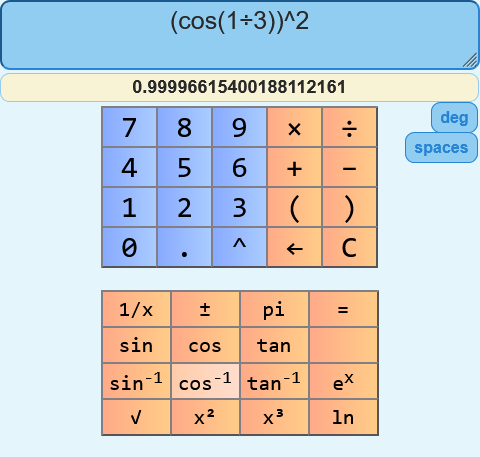
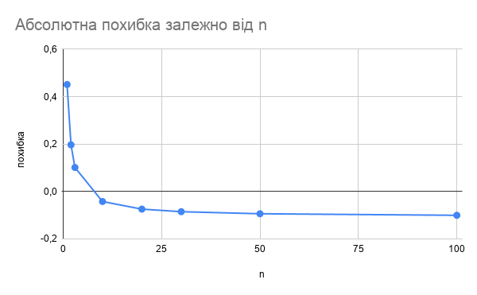

Національний технічний університет України

«Київський політехнічний інститут імені Ігоря Сікорського»

Факультет інформатики та обчислювальної техніки

Кафедра обчислювальної техніки

# Структури даних та алгоритмів
## Лабораторна робота №2
### Алгоритми з вкладеними циклами та метод динамічного програмування

### Виконав:
Студент групи: ІО-62

Усик К. Ю.

Номер у списку групи: 26

### Перевірив:
Русінов В. В.

Київ-2026

## 1. Мета лабораторної роботи
Засвоєння теоретичного матеріалу та набуття практичних навичок використання різних циклічних керуючих конструкцій, вкладених циклів, методу динамічного програмування та обчислення кількості операцій алгоритмів.

## 2 Постановка задачі

1. Задане натуральне число n. Обчислити значення заданої за варіантом формули (ряду або добутку, що наближено обчислює значення певної функції у заданій точці; точність наближення залежить від кількості ітерацій n).
2. Для розв'язання задачі написати **дві програми**:
   1. перша програма обчислює формулу за допомогою **вкладених циклів**;
   2. друга програма обчислює ту саму формулу за допомогою **одного циклу** з використанням **методу динамічного програмування** (тобто накопичуючи черговий доданок/множник на основі попереднього, без повторного обчислення статечних, факторіальних і подібних виразів «з нуля» на кожній ітерації).
3. Виконати розрахунок кількості операцій для кожного з алгоритмів за методикою, викладеною на лекції, додавши до неї підрахунок кількості викликів стандартних функцій.
4. Програма має правильно розв'язувати задачу при будь-якому заданому n, для якого результат обчислення коректно представляється типом `double`.
5. Результат виводити у форматі із **сімома знаками після коми**.

### Варіант завдання
| 26 | P = cos²x = [(π+2x)²/4] · ( Π(i=1..n) {1 − (π+2x)² / [4π²·Σ(j=1..i)(2j−1)]} )²  (x = 1/3) |
|-|-|

## 3. Текст програм
Код знаходиться в репозиторії

## 4. Скріншоти тестування програм
Для тестування обрано значення n: 2, 4, 12.

### Скріншот програм

### Скріншот калькулятора

### Таблиця результатів обчислень
| n | 2 | 4 | 12 |
|---|---|---|---|
| Програма    | 1.1968208 | 1.0511286 | 0.9469942 |
| Калькулятор | 1.1968207992085 | 1.0511286407476 | 0.9469941823215 |

## 5. Таблиця з значеннями лічильника операцій
| n | 1 | 2 | 3 | 10 | 20 | 30 | 50 | 100 |
|---|---|---|---|---|---|---|---|---|
| Кількість операцій, спосіб 1 (вкладені цикли) | 40 | 72 | 110 | 544 | 1674 | 3404 | 8664 | 32314 |
| Кількість операцій, спосіб 2 (динамічне програмування) | 36 | 57 | 78 | 225 | 435 | 645 | 1065 | 2115 |

## 6. Графік залежності кількості операцій від n

## 7. Результати перевірки правильності обчислень на калькуляторі

### Значення апроксимованої функції
(cos(1/3))² = 0.99996615400188112161

### Графік залежності похибки від n

## 8. Висновок
У ході виконання лабораторної роботи було створено дві програми для обчислення формули наближеного значення функції (cos(1/3))²: за допомогою вкладених циклів та динамічного програмування. Програми правильно обчислюють значення формули із точністю до семи цифр після коми.

Складність алгоритму для вкладених циклів складає 6n²+20n+14 а для методу динамічного програмування 20n+15. Отже, метод вкладених циклів має вищий порядок складності o(n²), ніж динамічного програмування - o(n).