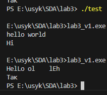
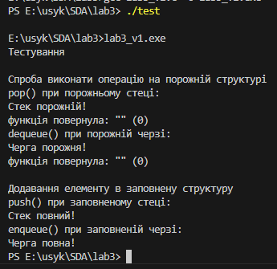
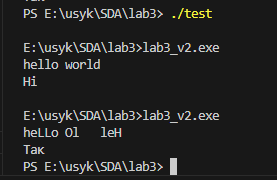
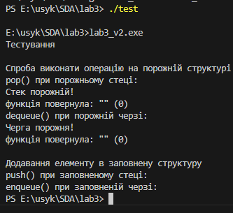

Національний технічний університет України

«Київський політехнічний інститут імені Ігоря Сікорського»

Факультет інформатики та обчислювальної техніки

Кафедра обчислювальної техніки

# Структури даних та алгоритмів
## Лабораторна робота №3
### Стеки та черги

### Виконав:
Студент групи: ІО-62

Усик К. Ю.

Номер у списку групи: 26

### Перевірив:
Русінов В. В.

Київ-2026

## 1. Мета лабораторної роботи
Засвоєння теоретичного матеріалу та набуття практичних навичок реалізації й застосування абстрактних структур даних **стек** (LIFO — «останнім прийшов, першим вийшов») та **черга** (FIFO — «першим прийшов, першим вийшов»), а також порівняння двох способів їхньої реалізації — на основі масиву фіксованого розміру та на основі однозв'язного списку.

## 2. Постановка задачі
1. Кожен варіант завдання визначає прикладну задачу (наприклад, перевірку збалансованості дужок, обчислення постфіксного виразу тощо) та структуру(и) даних, потрібну для її розв'язання (стек, чергу, або обидві).
2. Для розв'язання задачі написати **дві програми**, що реалізують ту саму структуру даних двома способами:
   1. на основі **одновимірного масиву фіксованого розміру** (з окремими змінними/індексами для вершини стека або голови й хвоста черги);
   2. на основі **однозв'язного списку** (динамічне виділення пам'яті: вузол зі значенням і вказівником на наступний вузол).

   Прикладна логіка (сама задача варіанта) в обох програмах має бути однаковою — відрізнятися має лише внутрішня реалізація стека/черги.
3. Обидві реалізації мають надавати єдиний узгоджений набір функцій, наприклад для стека: `push`, `pop`, `peek`, `is_empty`, `is_full`; для черги: `enqueue`, `dequeue`, `peek_front`, `is_empty`, `is_full`. Прикладна логіка (`main` і функції задачі) має викликати ці функції однаково незалежно від того, яка реалізація підключена — тобто дві програми відрізняються лише файлом/блоком, де реалізовані самі функції структури даних.
4. Розмір масиву для масивної реалізації взяти самостійно, достатнім для тестових прикладів (наприклад, 50–100 елементів), і оформити як іменовану константу.
5. **Масивна реалізація черги обов'язково має бути кільцевою (циклічною):** після заповнення останньої комірки масиву черга повинна продовжувати використовувати комірки, звільнені операціями `dequeue`, починаючи знову з початку масиву, а не вважати масив вичерпаним.

### Варіант завдання
| 26 | Те саме, що варіант 25 (Одночасно використовуючи стек і чергу, перевірити, чи є вхідне слово паліндромом: символи слова одночасно додаються в стек і в чергу; далі елементи виймаються по одному з обох структур і порівнюються (стек видає символи у зворотному порядку, черга — у прямому). Вивести «так»/«ні».), але перевірка має ігнорувати пробіли та регістр літер (тобто перевіряти, чи є паліндромом ціла фраза, наприклад «А роза упала на лапу Азора»). |
|-|-|

## 3. Текст програм
Код знаходиться в репозиторії: lab3_v1.c - масивна реалізація, lab3_v2.c - однозв'язні списки

## 4. Скріншоти тестування програм
### Масивна реалізація
#### Нетривіальні приклади

#### Тестування крайніх випадків

### Однозв'язні списки
#### Нетривіальні приклади

#### Тестування крайніх випадків

## 5. Висновок
У ході виконання лабораторної роботи було створено дві програми для перевірки, чи є введений рядок паліндромом (з ігноруванням регістру літер та пробілів): на основі одновимірного масиву фіксованого розміру та однозв'язного списку.

**Різниця у реалізації:**
Реалізація черги на основі фіксованого масиву є циклічною, це необхідно для того, щоб після видалення елементу з початку черги у звільнене місце можна було додати новий елемент.

**Пам'ять:**
Різниця між масивною та однозв'язносписковою реалізаціями полягає в тому, що масивна реалізація передбачає визначену наперед довжину речення та завжди вимагає однаковий об'єм пам'яті. Спроба додати елемент у заповнений/-у стек/чергу видає повідомлення про переповнення.

У той же час однозв'язкоспискова реалізація динамічно виділяє пам'ять, тому розмір рядка обмежений лише вільною пам'яттю ком'ютера. Обмеження на довжину вводу в цьому варіанті завдання є опціональним. Але реалізація на основі однозв'язного списку потребує 2 поля на кожен елемент стеку/черги - значення та вказівник на наступний, чим збільшує кількість необхідної оперативної пам'яті.

**Складність операцій:**
Більшість операцій обох варіантів мають складність o(1), однак в другому варіанті функції `size_queue()` та `size_stack()` мають складність o(n) оскільки для підрахунку розміру програма перебирає всі елементи черги/стеку.